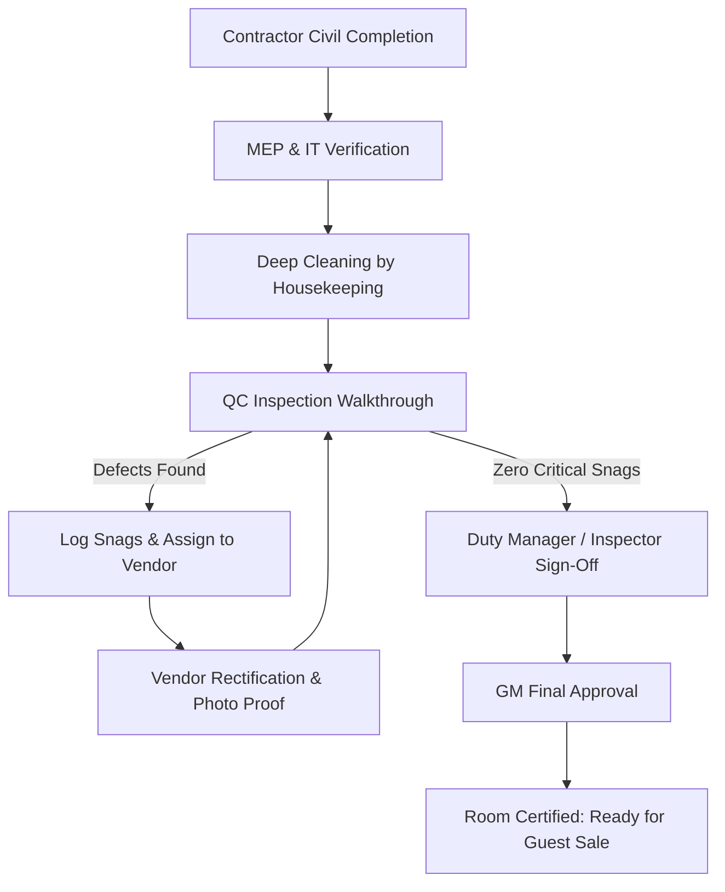

# Inspection Workflows & Checklists: Hotel Pre-Opening & QC

This reference provides standardized inspection checklists, snag categories, and handover procedures across all major hotel departments.

---

## 1. Departmental Pre-Opening Checklists

### 1. IT, Systems & Smart Hotel Tech
- [ ] **Door Lock & Access Control**: RFID keycard encoding, BLE mobile key Bluetooth lock sync, master key overrides, elevator access floor restrictions.
- [ ] **Guest Wi-Fi & Network**: Throughput test (>50 Mbps in room, balcony, bathroom), 802.1x roaming handoff between access points in hallways, captive portal redirect.
- [ ] **In-Room Entertainment (IPTV & Casting)**: Welcome message integration with PMS, Chromecast / Apple AirPlay pairing, soundbar optical sync, channel mapping.
- [ ] **PMS & POS Terminals**: Front Office Opera/Cloud PMS test check-in/out, POS printer routing to kitchen stations, payment gateway integration test.
- [ ] **Telephony & VoIP**: Bedside phone dial test (Front Desk, Emergency, Room Service, external outgoing), bathroom emergency call button.
- [ ] **CCTV & Security Control**: Camera blind-spot check (corridors, back of house, cashiers, luggage store), 30-day NVR recording test.
- [ ] **BGM (Background Music) & Public Address**: Zone volume controls (Lobby, Pool, Restaurant, Spa), emergency mic override test.

---

### 2. Housekeeping & Rooms Division
- [ ] **Linen & Bedding**: Mattress protector, crisp ironed sheets, pillow firmness variety, duvet tuck.
- [ ] **Bath & Vanity**: Zero water spots on chrome fixtures, silicon sealant mold-free and clean, mirror defogger function, amenities presentation (shampoo, soap, dental kit).
- [ ] **Curtains & Blackout**: 100% blackout seal without gap, sheer curtain glide smoothness.
- [ ] **Dust & Odor Audit**: Air purity, closet shelves, behind headboards, A/C vent dust check.

---

### 3. Engineering & MEP (Mechanical, Electrical, Plumbing)
- [ ] **HVAC / Air Conditioning**: Thermostat calibration (target 21°C within 15 min), noise level (<35 dB on low fan), condensation drain check.
- [ ] **Plumbing & Sanitary**: Hot water delivery under 15 seconds, water pressure > 2.0 bar, drain suction, toilet dual-flush volume.
- [ ] **Electrical & Lighting**: All switch circuits labeled, Master Switch "All Off" test, bedside USB-C charging output test, dimmer smoothness without flicker.
- [ ] **Emergency Systems**: Smoke detector test pulse, sprinkler cap removed, egress door automatic closer tension.

---

### 4. Food & Beverage (F&B) & Kitchens
- [ ] **Refrigeration & Walk-ins**: Chiller at 2°C - 4°C, Freezer at -18°C, digital temperature datalogger active.
- [ ] **Dishwashing & Sanitation**: High-temp sanitize rinse (>82°C) or chemical sanitizer PPM check.
- [ ] **Beverage & Bar**: Draft beer lines, espresso machine pressure & water softener, ice machine hygiene test.

---

## 2. Snag Severity Matrix

| Priority | Level | Response Target | Example |
| :--- | :--- | :--- | :--- |
| **P1 - Critical Blocker** | Handover / Life Safety | 24 Hours | Balcony railing loose, door lock failure, major water leak, smoke detector fault |
| **P2 - Major Defect** | Operational / Guest Impact | 48 Hours | A/C not cooling, IPTV black screen, hot water lukewarm, vanity mirror cracked |
| **P3 - Minor Defect** | Aesthetic / Non-Critical | 5 Days | Wall paint scuff, drawer soft-close adjustment, silicone bead uneven |
| **P4 - Snag / Touch-up** | Punch list final clean | 7 Days | Missing screw cap, sticker residue on window, slight grout discoloration |

---

## 3. Room Certification Workflow (Handover Flow)

